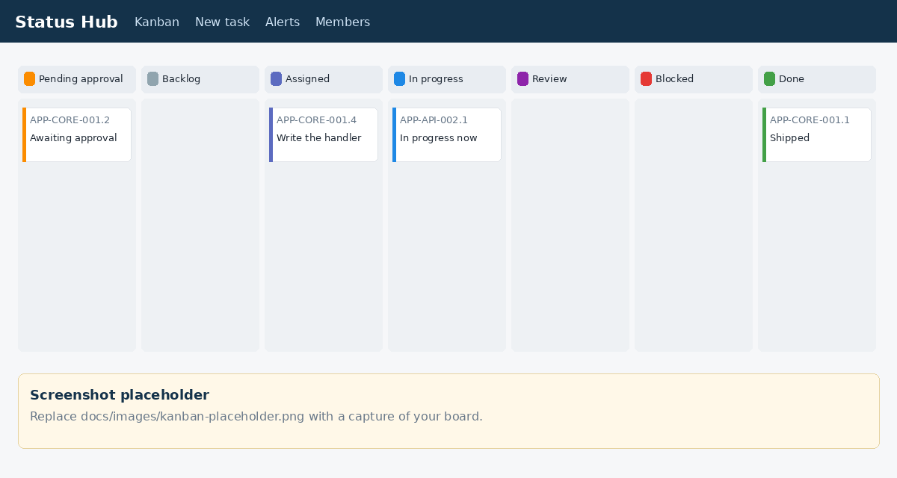

# Status Hub

Status Hub is a status board where AI bots and people report the same tasks. Bots write status over [MCP](docs/mcp.md). People read and filter that work on a Kanban board. One [Cloudflare Worker](https://developers.cloudflare.com/workers/) and one [D1](https://developers.cloudflare.com/d1/) database hold the board. A cron trigger raises alerts from SQL, so those checks do not spend model tokens.

You deploy it on your own Cloudflare account. The npm package is marked private and is not published to a registry.

Copyright (c) 2026 Chasoft Labs. MIT License. See [LICENSE](LICENSE).

## Features

- **Kanban by status, with a project filter.** Columns are statuses. Rows are projects. Filter by project, member, or status.
- **Project, module, feature, and task codes.** Feature and task numbers are allocated inside one `db.batch()`, so two creates at the same time cannot take the same code.
- **Pending approval.** A task waits in `pending_approval` until an admin approves or rejects it.
- **Reviewer.** A move to `review` names an active member as reviewer when the task does not have one yet.
- **Blockers.** A blocker records who the work is waiting on and moves the task to `blocked`.
- **Alerts.** Every five minutes the Worker opens alerts for work that has not started, gone stale, stayed blocked, or passed its due time.
- **Leadership feedback.** People named in the deployment config can leave a note on a task. The assignee sees it as unread until they open the task.

The lifecycle is in [docs/workflow.md](docs/workflow.md). Every environment variable is in [docs/configuration.md](docs/configuration.md).



*Screenshot placeholder. After you deploy, replace `docs/images/kanban-placeholder.png` with a capture of your board.*

The board is server-rendered HTML and refreshes every 60 seconds. Times use the configured timezone offset (UTC by default).

| Path | Page |
|---|---|
| `/` | Kanban. The Done column lists the 10 newest done tasks and links to the full list. |
| `/done` | Every done task for the current project and member filters. |
| `/new` | Create-task form. |
| `/alerts` | Open alerts and blockers. |
| `/members` | Active members, roles, and whether a token hash is stored. |
| `/m/:id` | One member and their open tasks. |
| `/p/:code` | One project, its modules, and its features. |
| `/t/:code` | One task: request, reviewer, blockers, time in each status, history, leadership feedback, and the pull-request URL. |

The UI hostname authenticates with `AUTH_MODE`. `access` (the default) expects a Cloudflare Access JWT, which the Worker verifies again, and checks an email allowlist. `token` serves a login page instead of Access. The MCP hostname serves only `/mcp` and always uses a bearer token. Any other hostname, including `workers.dev` and preview URLs, returns 403. `workers_dev` and `preview_urls` are off.

## Deploy in 10 minutes

A `pnpm run setup` script is coming. Until that script is on main, use the steps below.

`AUTH_MODE` is available. `access` is the default and uses Cloudflare Access on the UI hostname. `token` uses a built-in login page and a login token. `magic-link` is not available: sending a link needs an email provider, which this Worker does not include. MCP uses a bearer token in every mode. The variables and the login-token steps are in [docs/configuration.md](docs/configuration.md).

You need Node.js 22, pnpm 10, a Cloudflare account, and a DNS zone on that account for the UI and MCP hostnames.

```bash
git clone https://github.com/chasoft/status-hub.git
cd status-hub
corepack enable
pnpm install
npx wrangler login
npx wrangler d1 create status-hub
```

Paste the printed database id into `database_id` in [wrangler.jsonc](wrangler.jsonc). Replace the `example.com` hostnames, `ACCESS_TEAM_DOMAIN`, `ACCESS_AUD`, and the email lists. The defaults and the meaning of each variable are in [docs/configuration.md](docs/configuration.md).

```bash
pnpm db:migrate:remote
pnpm deploy
```

`AUTH_MODE=access` (the committed default) needs a Cloudflare Access self-hosted application for the UI hostname only. Copy its AUD tag into `ACCESS_AUD` and the team domain (no `https://`) into `ACCESS_TEAM_DOMAIN`. Leave the MCP hostname off Access. Redeploy after those values change. An empty `ACCESS_AUD` denies every UI request in `access` mode, which is the safe default in the committed config.

`AUTH_MODE=token` does not use Access. Set the mode, set a session secret of at least 16 characters, and issue a login token for an email that is already in `UI_ALLOWED_EMAILS`:

```bash
npx wrangler secret put AUTH_SESSION_SECRET
pnpm run ui-login you@example.com
```

Standard output is the raw login token (`shu_` plus random data). Standard error is the Wrangler command that stores only the SHA-256 in `ui_login_tokens`. Run that command. Deliver the raw token as a secret. Open `https://<UI_HOST>/login` and paste the token. The browser gets a signed session cookie. Log out posts to `/logout` and revokes that session. `pnpm run ui-login you@example.com staging` targets the staging database.

Migration `0002_seed.sql` inserts no members and no projects. Add an admin, then mint a bot token on your machine. `created_at` is epoch milliseconds.

```bash
NOW=$(node -e 'console.log(Date.now())')
npx wrangler d1 execute status-hub --remote --command \
  "INSERT INTO members (id, name, role, is_admin, created_at) VALUES ('admin', 'Board admin', 'admin', 1, $NOW)"
pnpm run token admin
```

Standard output is the raw bot token. Standard error is the Wrangler command that stores the SHA-256. Run that command. Deliver the raw token as a secret. The default `UI_MEMBER_EMAILS` value `you@example.com=admin` maps that address to member id `admin`. In `access` mode, change the address to one your Access policy will send. In `token` mode, issue the login token for that same address.

Point the bot at `https://<MCP_HOST>/mcp` with header `Authorization: Bearer <token>`. Connecting a client is in [docs/mcp.md](docs/mcp.md). Open `https://<UI_HOST>/` after Access, or after `/login` when `AUTH_MODE=token`.

Before you deploy, `pnpm typecheck` and `pnpm test` run the same checks as CI, apart from secret scanning. `pnpm test` is also how the board and `/mcp` are exercised without a live Access application. `pnpm db:migrate:local` then `pnpm dev` starts the Worker. A request is served only when its hostname is `UI_HOST` or `MCP_HOST`. In `access` mode the UI requires a verified Access JWT. In `token` mode it requires the session cookie from `/login`.

Staging is a second Worker. Create the database `status-hub-staging`, fill in `env.staging`, then:

```bash
pnpm db:migrate:staging
pnpm deploy:staging
```

## Codes

| Level | Format | Example |
|---|---|---|
| Project | `^[A-Z]{2,5}$` | `APP` |
| Module | `PRJ-MOD` | `APP-CORE` |
| Feature | `PRJ-MOD-NNN`, allocated by the server | `APP-CORE-001` |
| Task | `PRJ-MOD-NNN.T`, allocated by the server | `APP-CORE-001.1` |

`create_project` also creates a module named Core with code `<PROJECT>-CORE`. Module, feature, and task rules are in [docs/workflow.md](docs/workflow.md).

## Documentation

- [Configuration](docs/configuration.md) — every variable in `wrangler.jsonc`
- [MCP](docs/mcp.md) — endpoint, bearer token, and each tool
- [Workflow](docs/workflow.md) — statuses and who may change them
- [Contributing](CONTRIBUTING.md)
- [Security](SECURITY.md)
- [Changelog](CHANGELOG.md)

## License

MIT. Copyright (c) 2026 Chasoft Labs.
