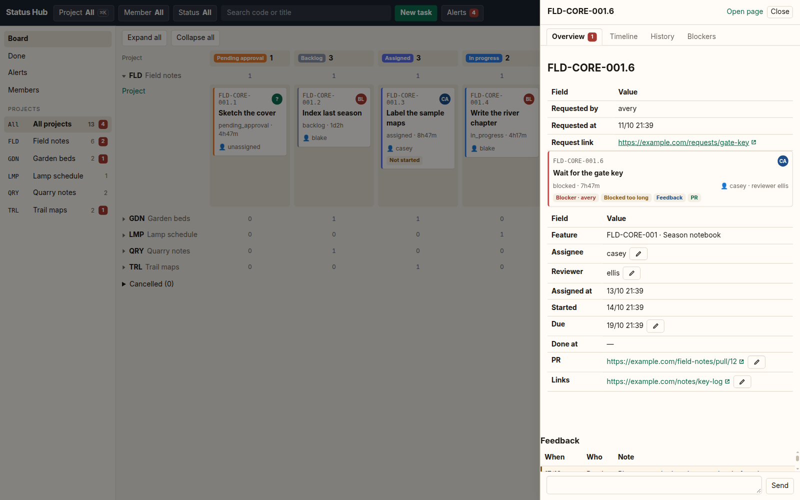
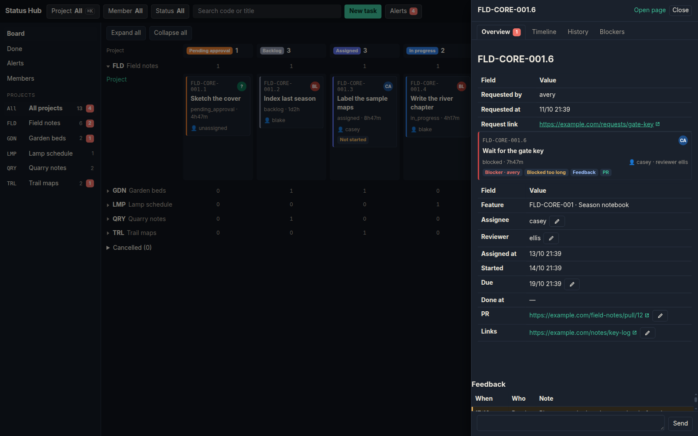

# Status Hub

Status Hub is a status board where AI bots and people report the same tasks. Bots write status over [MCP](docs/mcp.md). People read and filter that work on a Kanban board. One [Cloudflare Worker](https://developers.cloudflare.com/workers/) and one [D1](https://developers.cloudflare.com/d1/) database hold the board. A cron trigger raises alerts from SQL, so those checks do not spend model tokens.

You deploy it on your own Cloudflare account. The npm package is marked private and is not published to a registry.

Copyright (c) 2026 Chasoft Labs. MIT License. See [LICENSE](LICENSE).

## Features

- **Dashboard by status and project.** Columns are statuses. Rows are projects. A project list and a quick switcher choose one swimlane or all of them. Filter by member, status, or search. Cards open in a drawer. The board polls itself instead of reloading the page.
- **Project, module, feature, and task codes.** Feature and task numbers are allocated inside one `db.batch()`, so two creates at the same time cannot take the same code.
- **Pending approval.** A task waits in `pending_approval` until an admin approves or rejects it.
- **Reviewer.** A move to `review` names an active member as reviewer when the task does not have one yet.
- **Blockers.** A blocker records who the work is waiting on and moves the task to `blocked`.
- **Alerts.** Every five minutes the Worker opens alerts for work that has not started, gone stale, stayed blocked, or passed its due time.
- **Leadership feedback.** People named in the deployment config can leave a note on a task. The assignee sees it as unread until they open the task.

The lifecycle is in [docs/workflow.md](docs/workflow.md). Every environment variable is in [docs/configuration.md](docs/configuration.md).





The board fills the viewport. On a desktop the page itself does not scroll: each column scrolls, and so does the task drawer. An expanded project row is only as tall as its cards, up to the board height, so collapsed rows sit directly underneath. With more than three projects, All projects starts with the swimlanes collapsed. `?project=CODE` keeps one project. The choice is stored in the browser. A task click opens a drawer; `/t/:code` remains the full page when you open it directly or without JavaScript. The task is split into Overview, Timeline, History, and Blockers. `?tab=` selects one, and the browser remembers the last tab. Leadership feedback is listed on Overview, and the note field stays pinned to the bottom of that tab. Editable fields (PR, links, assignee, reviewer, due date, priority) show the value with a pencil; the input replaces it in place. Create task, filters, and confirmations stay in dialogs and popovers. Links to another site open in a new tab. Buttons, inputs, and badges share a small corner radius.

`GET /api/board` returns the filtered board as JSON for the signed-in UI. The page polls it every 60 seconds and updates cards without closing the drawer or jumping the columns. Times use the configured timezone offset (UTC by default). The colors follow `prefers-color-scheme`.

| Path | Page |
|---|---|
| `/` | Board. Columns are statuses, rows are projects. The Done column lists the 10 newest done tasks and links to the full list. |
| `/api/board` | Read-only JSON for the same filters. Requires the same UI login as the board. |
| `/done` | Every done task for the current project and member filters. |
| `/new` | Create-task form. The board also opens this form in a dialog. |
| `/alerts` | Open alerts and blockers. |
| `/members` | Active members, roles, and whether a token hash is stored. |
| `/m/:id` | One member and their open tasks. |
| `/p/:code` | One project, its modules, and its features. |
| `/t/:code` | One task: request, reviewer, blockers, time in each status, history, leadership feedback, and the pull-request URL. From the board this opens as a drawer. |

The UI hostname authenticates with `AUTH_MODE`. `access` (the default) expects a Cloudflare Access JWT, which the Worker verifies again, and checks an email allowlist. `token` serves a login page instead of Access. The MCP hostname serves only `/mcp` and always uses a bearer token. Any other hostname, including `workers.dev` and preview URLs, returns 403. `workers_dev` and `preview_urls` are off.

## Deploy in 10 minutes

`pnpm run setup` is the bootstrap. It checks Wrangler login, creates or reuses the D1 database by name, writes gitignored `wrangler.local.jsonc` from [wrangler.jsonc](wrangler.jsonc), applies migrations, creates the first admin member, and prints a one-time MCP token. Only the SHA-256 is stored. Run it again safely: an existing database is reused, and an existing admin token stays unless you pass `--rotate-token`. Every flag is also listed by `pnpm run setup -- --help` and in [docs/configuration.md](docs/configuration.md).

`AUTH_MODE` is available. `access` is the default and uses Cloudflare Access on the UI hostname. `token` uses a built-in login page and a login token. `magic-link` is not available: sending a link needs an email provider, which this Worker does not include. MCP uses a bearer token in every mode. The variables and the login-token steps are in [docs/configuration.md](docs/configuration.md).

You need Node.js 22, pnpm 10, a Cloudflare account, and a DNS zone on that account for the UI and MCP hostnames.

```bash
git clone https://github.com/chasoft/status-hub.git
cd status-hub
corepack enable
pnpm install
pnpm exec wrangler login
pnpm run setup
pnpm run deploy
```

The prompts are the org name, timezone, UI hostname, MCP hostname, owner ids, approver ids, the first admin's id, name, and email, and UI auth mode (`access` or `token`). Press Enter to keep `access`. Timezone accepts an IANA name (`America/Los_Angeles`), `UTC`, a clock offset (`+08:00` or `-5`), or minutes east of UTC (`-300`). A named zone uses the offset in effect when you run setup. After a daylight-saving change, run setup again. Press Enter on owner or approver ids to leave that list empty.

`access` is the default. Create a Cloudflare Access self-hosted application for the UI hostname only. Pass the team domain (no `https://`) and the AUD tag to the prompts, or to `--access-team-domain` and `--access-aud`. Leave the MCP hostname off Access. An empty `ACCESS_AUD` denies every UI request in `access` mode. Redeploy after you change those values: `pnpm run deploy`.

`token` does not use Access. Setup writes `AUTH_MODE` into `wrangler.local.jsonc`, runs `wrangler secret put AUTH_SESSION_SECRET` with a generated value of at least 16 characters, and prints a one-time UI login token (`shu_…`) for the admin email. Only the SHA-256 is stored in `ui_login_tokens`. The secret is not printed and is not written into the config file. Open `https://<UI_HOST>/login` and paste the token. The browser gets a signed session cookie. Log out posts to `/logout` and revokes that session. A later setup leaves an existing secret and login token in place unless you pass `--rotate-session-secret` or `--rotate-ui-token`. `wrangler secret put` uploads the secret onto the Worker, creating a draft script when the Worker does not exist yet. `pnpm run deploy` publishes the real script and keeps that secret. Further login tokens still use `pnpm run ui-login <email>`.

Stdout is each raw token, once: the MCP token, then the UI login token when the mode is `token`. Deliver them as secrets. The script also sets `UI_ALLOWED_EMAILS`, `UI_MEMBER_EMAILS`, and `LEADERSHIP_AUTHORS` from that admin. The placeholder `you@example.com` is removed. Further members still use SQL plus `pnpm run token <member-id>`, described in [docs/configuration.md](docs/configuration.md).

Point the bot at `https://<MCP_HOST>/mcp` with header `Authorization: Bearer <token>`. Connecting a client is in [docs/mcp.md](docs/mcp.md). Open `https://<UI_HOST>/` after Access, or after `/login` when `AUTH_MODE=token`.

### Non-interactive setup

`--yes` (or `CI`, or `STATUS_HUB_NONINTERACTIVE=1`) skips prompts. Flags override the matching environment variable. Owner and approver ids default to empty when omitted.

```bash
pnpm run setup -- --yes \
  --org "Acme" \
  --timezone UTC \
  --ui-host status.acme.example \
  --mcp-host mcp.acme.example \
  --owner-ids ada \
  --approver-ids cara \
  --admin-id ada \
  --admin-name "Ada Lovelace" \
  --admin-email ada@acme.example \
  --auth-mode access \
  --access-team-domain acme.cloudflareaccess.com \
  --access-aud "<aud-tag>"
```

Token mode uses the same required flags plus `--auth-mode token`. Omit the Access flags. Setup uploads `AUTH_SESSION_SECRET` and prints the UI login token.

| Flag | Environment variable | Required with `--yes` |
|---|---|---|
| `--org` | `STATUS_HUB_ORG_NAME` | yes |
| `--timezone` | `STATUS_HUB_TIMEZONE` | yes |
| `--ui-host` | `STATUS_HUB_UI_HOST` | yes |
| `--mcp-host` | `STATUS_HUB_MCP_HOST` | yes |
| `--admin-id` | `STATUS_HUB_ADMIN_ID` | yes |
| `--admin-name` | `STATUS_HUB_ADMIN_NAME` | yes |
| `--admin-email` | `STATUS_HUB_ADMIN_EMAIL` | yes |
| `--auth-mode` | `STATUS_HUB_AUTH_MODE` | no, default `access` (`token` mints the UI login) |
| `--rotate-ui-token` | `STATUS_HUB_ROTATE_UI_TOKEN=1` | no |
| `--rotate-session-secret` | `STATUS_HUB_ROTATE_SESSION_SECRET=1` | no |
| `--owner-ids` | `STATUS_HUB_OWNER_IDS` | no |
| `--approver-ids` | `STATUS_HUB_APPROVER_IDS` | no |
| `--database-name` | `STATUS_HUB_DATABASE_NAME` | no, default `status-hub` |
| `--staging` | `STATUS_HUB_STAGING=1` | no |
| `--staging-ui-host` | `STATUS_HUB_STAGING_UI_HOST` | with `--staging` |
| `--staging-mcp-host` | `STATUS_HUB_STAGING_MCP_HOST` | with `--staging` |
| `--staging-database-name` | `STATUS_HUB_STAGING_DATABASE_NAME` | no, default `status-hub-staging` |
| `--access-team-domain` | `STATUS_HUB_ACCESS_TEAM_DOMAIN` | no |
| `--access-aud` | `STATUS_HUB_ACCESS_AUD` | no |
| `--rotate-token` | `STATUS_HUB_ROTATE_TOKEN=1` | no |
| `--dry-run` | `STATUS_HUB_DRY_RUN=1` | no |
| `--skip-login-check` | `STATUS_HUB_SKIP_LOGIN=1` | no |

`--dry-run` prints the generated config and does not call Cloudflare or write a file. For CI, set `CLOUDFLARE_API_TOKEN` and `CLOUDFLARE_ACCOUNT_ID` instead of `wrangler login`.

Before you deploy, `pnpm typecheck` and `pnpm test` run the same checks as CI, apart from secret scanning. `pnpm test` is also how the board and `/mcp` are exercised without a live Access application. `pnpm db:migrate:local` then `pnpm dev` starts the Worker against `wrangler.jsonc`. After setup, `pnpm exec wrangler dev --config wrangler.local.jsonc` uses the hostnames you entered. A request is served only when its hostname is `UI_HOST` or `MCP_HOST`. In `access` mode the UI requires a verified Access JWT. In `token` mode it requires the session cookie from `/login`.

Staging is a second Worker and a second database. Pass `--staging` plus the staging hostnames (the same fields, with `STATUS_HUB_STAGING_UI_HOST` and `STATUS_HUB_STAGING_MCP_HOST`). Setup creates or reuses `status-hub-staging`, writes `env.staging` in `wrangler.local.jsonc`, migrates it, and prints a separate MCP token. In `token` mode it also uploads a separate `AUTH_SESSION_SECRET` and prints a separate UI login token.

```bash
pnpm run deploy:staging
```

`pnpm run deploy` and `pnpm run deploy:staging` use `wrangler.local.jsonc` when that file exists. Later migrations use `pnpm db:migrate:remote` and `pnpm db:migrate:staging`, which read the same file.

## Codes

| Level | Format | Example |
|---|---|---|
| Project | `^[A-Z]{2,5}$` | `APP` |
| Module | `PRJ-MOD` | `APP-CORE` |
| Feature | `PRJ-MOD-NNN`, allocated by the server | `APP-CORE-001` |
| Task | `PRJ-MOD-NNN.T`, allocated by the server | `APP-CORE-001.1` |

`create_project` also creates a module named Core with code `<PROJECT>-CORE`. Module, feature, and task rules are in [docs/workflow.md](docs/workflow.md).

## Documentation

- [Configuration](docs/configuration.md) — every variable in `wrangler.jsonc`
- [MCP](docs/mcp.md) — endpoint, bearer token, and each tool
- [Workflow](docs/workflow.md) — statuses and who may change them
- [Contributing](CONTRIBUTING.md)
- [Security](SECURITY.md)
- [Changelog](CHANGELOG.md)

## License

MIT. Copyright (c) 2026 Chasoft Labs.
